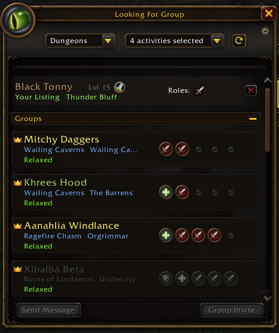
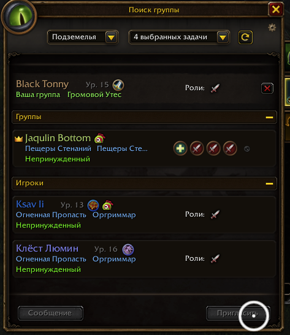

# WhereYouAt Universal

See where players are, right in the Looking For Group browser.

WhereYouAt Universal shows the current zone of group leaders and individual players looking for a group, next to their selected activity. See who is already near the dungeon and who is still in town or elsewhere.

## Features

- Displays zones for group leaders and individual players in the LFG browser.
- Automatically uses the client’s localized font instead of a fixed font file.
- No configuration, manual font replacement, or additional libraries required.
- Preserves the original addon’s layout and behavior.

Zones are displayed when the game provides this information. Long names may be shortened to fit the available space.

## Compatibility

Designed for **World of Warcraft: Forever**. Tested by the maintainer in the English and Russian clients on **Forever beta 1.60.1.70450** (Interface 16001), October 19, 2026.

Other client languages use the same automatic font selection but have not yet been tested. This addon displays zone names supplied by the game; it does not translate them. Other addons or replacement font files that change the client’s fonts can affect the result.

## Installation

1. Download the release ZIP and extract it.
2. Copy the `WhereYouAtUniversal` folder into your game’s `Interface/AddOns/` directory. For the current Forever beta, use `_classic_beta_/Interface/AddOns/`.
3. Disable the original **WhereYouAt / Where You At?**, if installed, and enable **WhereYouAt Universal**. Do not enable both versions together.
4. Restart the game and open the Looking For Group browser.

To switch back, disable Universal and enable the original. No saved settings are created.

## Screenshots

### English client

### Russian client

## Other languages

### Русский — проверено

Показывает текущую зону лидеров групп и игроков, ищущих группу, прямо в окне поиска группы. Автоматически использует штатный шрифт языка клиента. Не требует настройки. Работа проверена на русском клиенте.

### Español — España y Latinoamérica (pendiente de comprobar)

Muestra la zona actual de los líderes de grupo y de los jugadores que buscan grupo directamente en el buscador de grupos. Utiliza automáticamente la fuente del cliente y no requiere configuración.

¿Juegas en español? Cuéntanos si los nombres de las zonas se muestran correctamente e indica si utilizas el cliente de España o de Latinoamérica. Si encuentras algún problema, incluye las versiones del juego y del addon y, si es posible, una captura de pantalla.

### Português — Brasil (ainda não testado)

Mostra a zona atual dos líderes de grupo e dos jogadores que procuram um grupo diretamente no localizador de grupos. Usa automaticamente a fonte do cliente e não requer configuração.

Você joga em português brasileiro? Conte nos comentários se os nomes das zonas aparecem corretamente. Se encontrar algum problema, informe as versões do jogo e do addon e, se possível, envie uma captura de tela.

### Deutsch — noch nicht getestet

Zeigt das aktuelle Gebiet von Gruppenleitern und Spielern auf Gruppensuche direkt im Gruppenbrowser an. Verwendet automatisch die Schriftart des Clients. Keine Einrichtung erforderlich.

Spielst du auf Deutsch? Schreib uns in den Kommentaren, ob die Gebietsnamen korrekt angezeigt werden. Falls Probleme auftreten, gib bitte die Spiel- und Addon-Version an und füge möglichst einen Screenshot hinzu.

### Français — pas encore testé

Affiche la zone actuelle des chefs de groupe et des joueurs à la recherche d’un groupe directement dans la recherche de groupe. Utilise automatiquement la police du client, sans configuration.

Vous jouez en français ? Dites-nous dans les commentaires si les noms des zones s’affichent correctement. En cas de problème, précisez les versions du jeu et de l’addon et joignez si possible une capture d’écran.

### 한국어 — 아직 테스트되지 않음

파티 찾기 목록에서 파티장과 파티를 찾는 개별 플레이어의 현재 지역을 표시합니다. 클라이언트 언어에 맞는 기본 글꼴을 자동으로 사용하며 별도의 설정이 필요하지 않습니다.

한국어 클라이언트에서 플레이하시나요? 지역 이름이 올바르게 표시되는지 댓글로 알려 주세요. 문제가 있다면 게임 및 애드온 버전과 함께 가능하면 스크린샷도 첨부해 주세요.

### 繁體中文 — 尚未測試

直接在尋求組隊介面中顯示隊長及尋求組隊玩家目前所在的區域。自動使用遊戲客戶端語言的預設字型，無需設定。

您使用繁體中文遊戲客戶端嗎？歡迎留言告訴我們區域名稱是否正確顯示。若遇到問題，請提供遊戲與插件版本，並盡可能附上螢幕截圖。

## Credits and license

Based on **WhereYouAt 1.0.0 by samfoxy**, copyright (c) 2026 samfoxy. This fork replaces the fixed font with the client’s localized font while preserving the original functionality.

Released under the **MIT License**. The original copyright notice and license are included unchanged in [LICENSE](LICENSE).
